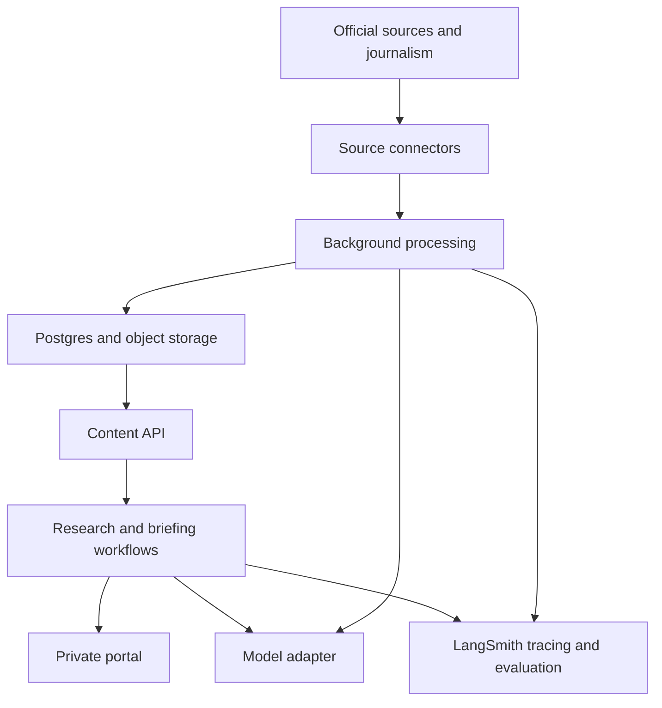

# Architecture and service boundaries

The content platform is reusable independently of the portal and analyst workflows. It owns collection, processing, storage, and retrieval behind a versioned API. Research consumes that API and must not embed publisher extraction or bypass its access controls.

## Deployable applications

- [Portal](../apps/portal/README.md): Next.js UI and authenticated research control routes. Long workflows dispatch to the worker.
- [Content API](../apps/content-api/README.md): Hono service exposing evidence and retrieval contracts.
- [Worker](../apps/worker/README.md): Node processing and workflow execution. Separate collection and analyst execution paths; do not run all analysts hourly per article.

Keeping research route handlers in the portal server is a scaffold layout choice; shared research logic remains framework-independent and can later have its own host. Apps may deploy separately without relocating business logic. Shared packages hold logic; apps compose dependencies and transport handlers.

## Working defaults

| Component | Working default / unresolved detail |
| --- | --- |
| Portal | Next.js, TypeScript, Tailwind, shadcn/ui |
| Content API | TypeScript, Hono, schema-validated REST |
| Background processing | Node.js workers |
| Hosting | GCP Cloud Run services and Cloud Run Jobs |
| Scheduling | Cloud Scheduler; application-managed user schedules |
| On-demand dispatch | Cloud Tasks or equivalent durable adapter |
| Database | PostgreSQL full-text search and pgvector; benchmark Cloud SQL sizing |
| Files and secrets | Google Cloud Storage and Secret Manager |
| Login | Clerk candidate; Firebase Authentication alternative |
| Workflows | LangGraph library |
| Models | Provider-neutral adapter; OpenRouter candidate with direct-provider support |
| AI telemetry | LangSmith Developer candidate |
| Infrastructure monitoring | Cloud Logging and Monitoring |

These choices are provisional pending source, retrieval, and cost measurements. No resource creation is authorized by the specification alone.

## Security boundaries

End-user identity resolves workspace membership. Service identities govern internal workloads. Enforce server-side permissions for documents, evidence passages, artifacts, semantic retrieval, jobs, and caches. Apply permission filters before returning evidence. Separate internal connector/ingestion endpoints from user retrieval and require service authentication.

Treat retrieved document content as untrusted evidence. It cannot change tools, permissions, workspace scope, or spending limits. Keep credentials and unnecessary private content out of telemetry. The database remains authoritative for evidence, history, outputs, and reservations.
